<p align="center">
  
</p>

<p align="center">
  <a href="https://github.com/retvest/ril/releases/tag/v0.2.1"></a>
  <a href="BINARY-LICENSE.txt"></a>
  <a href="LAWS-SPEC.md"></a>
  <a href="conformance/"></a>
  <a href="https://github.com/retvest/ril/releases/tag/v0.2.1"></a>
  <a href="https://retvest.com/products/ril/"></a>
</p>

# Stop trusting `AGENTS.md` prose. Write laws AI cannot break.

Prompts and `AGENTS.md` files are suggestions. When an AI coding agent is 20 tool calls deep, it ignores them, runs destructive commands, or quietly weakens a test to make its own pull request pass.

**RIL (`laws.ril`)** turns your invariants into hard, machine-checked laws enforced both at runtime and at merge time. Before an AI acts, RIL evaluates action laws inline in **6.6 ms** with zero database required: `forbid` beats `ask`, `ask` beats `permit`, unmatched actions deny by default, evaluation errors fail closed, and exit codes (`0` allow, `2` ask, `3` deny) plug straight into Claude Code, Cursor, Codex, or MCP hooks. Before an AI merges code, `ril laws diff` blocks any pull request that removes or weakens a law, and `ril laws coverage` enforces code-law coverage across critical directories.

<p align="center">
  
</p>

Across Retvest's own Rust, Kotlin Multiplatform, and TypeScript repositories, **46 live `laws.ril` laws** (including 10 sub-second Kani CBMC proofs and 20,000-trace Quint models) caught **3 real production bugs on day one**: stale claim recovery overwrites, unclaimed completion mismatches, and a walkthrough dwell-state leak. Try the interactive browser evaluator live at **[retvest.com/products/ril](https://retvest.com/products/ril/)**.

## 30-Second Quickstart (macOS, Linux, Windows)

Install the single zero-dependency `ril` binary (`v0.2.1`, SHA-256 verified):

```sh
# macOS & Linux
curl -fsSL https://raw.githubusercontent.com/retvest/ril/main/install.sh | sh
```

```powershell
# Windows (PowerShell)
irm https://raw.githubusercontent.com/retvest/ril/main/install.ps1 | iex
```

Generate a starter `laws.ril`, verify its RFC 8785 canonical SHA-256 digest, evaluate live AI actions offline, and test the PR weakening gate:

```sh
# 1. Generate a verified starter laws.ril (claude-code, rust, python, typescript, or general)
ril laws init --template claude-code

# 2. Verify syntax and print the canonical RFC 8785 SHA-256 digest
ril laws check laws.ril

# 3. Evaluate an AI shell command offline (exits 3 on DENY, 2 on HOLD/ask, 0 on ALLOW)
ril laws eval laws.ril --action exec --resource ShellCommand:bash \
  --context '{"command":"rm -rf /","workspace":"local"}'

# 4. Block AI pull requests from removing or weakening any law or verifier target
ril laws diff origin/main/laws.ril laws.ril

# 5. Enforce code-law coverage on critical directories
ril laws coverage laws.ril --root . --require-covered "src/auth/**"
```

## Drop-In Starter Packs & Integrations

Every template in [examples/](examples/) is verified against `ril laws check` and ready to copy into your repository.

| Starter Pack | Path | What It Enforces |
|---|---|---|
| **Claude Code / Agent Hook** | [examples/claude-code-mcp/](examples/claude-code-mcp/) | Blocks `rm -rf`, `git push --force`, `git reset --hard`, `DROP TABLE`, and `.env` / `.ssh` reads; holds `curl`, `wget`, and `git push` for human approval. Includes a zero-database `PreToolUse` hook script ([pre-tool-use.sh](examples/claude-code-mcp/pre-tool-use.sh)). |
| **GitHub Actions Merge Gate** | [examples/github-action.yml](examples/github-action.yml) | Installs `ril` with SHA-256 verification, checks `laws.ril`, runs `ril laws diff` against `origin/main` to block AI PRs from weakening laws, and checks `ril laws coverage`. |
| **Rust + Kani CBMC** | [examples/rust-kani/laws.ril](examples/rust-kani/laws.ril) | Binds private-work isolation and fail-closed auth invariants to sub-second Kani CBMC proof harnesses (`0.02s`) and `cargo test --locked`. |
| **Python / FastAPI** | [examples/python-fastapi/laws.ril](examples/python-fastapi/laws.ril) | Enforces multi-tenant isolation, holds external customer exports for human approval, and binds auth directories to `pytest`. |
| **TypeScript / Next.js** | [examples/typescript-nextjs/laws.ril](examples/typescript-nextjs/laws.ril) | Holds production database mutations for human approval, forbids `.env` secret reads, and binds API routes to `npm test`. |

## What `laws.ril` Looks Like

```ril
laws "Acme platform" version 1

# Action law: decided inline before an AI touches customer data
law private-work-is-private
  says  "An admin never reads another user's Private Work."
  why   "Private Work is personal, even inside a company account."
  on    action read of PrivateWork
  forbid when resource.owner != principal
  evidence proved by kani "private_work::read_decision" in "rust/api"

# Action law: hold irreversible external actions for human approval
law export-needs-approval
  says  "Sending customer data outside the company needs a person's approval."
  why   "Data leaving the company is not reversible."
  on    action send of CustomerData
  ask   when context.destination.external
  evidence watched

# Code law: bounded formal verification over a multi-step protocol
law action-lifecycle-model
  says  "An action never has two live claims and never settles from a stale claim."
  why   "Exclusive execution leases prevent duplicate side effects."
  on    code "src/claims.rs", "formal/action_lifecycle.qnt"
  evidence proved by quint "formal/action_lifecycle.qnt"

# Code law: RIL subsumes Bend proofs too
law settlement-kernel-proof
  says  "Settlement totals conserve balance across every transfer."
  why   "Accounting invariants must be mathematically unbreakable."
  on    code "kernels/settlement.bend"
  evidence proved by bend "kernels/LAWS.bend"
```

## Why RIL?

| Capability | `AGENTS.md` / Prompts | Traditional Policy Engines | Bend (`LAWS.bend`) | **RIL (`laws.ril`)** |
|---|---|---|---|---|
| **Works on Rust, Kotlin, TS, Python, Go, SQL** | Yes (unenforced) | Partial | No (Bend-only rewrite) | **Yes — any language** |
| **Mathematical proofs (`proved`)** | No | No | Yes (`<1s` in Bend) | **Yes (`kani` in `0.02s`, `quint`, `verus`, `lean`, `bend`)** |
| **Zero-DB offline action evaluation (`6.6 ms`)** | No | Needs server/SDK | No | **Built-in (`ril laws eval`, exit `0` / `2` / `3`)** |
| **Governs live AI actions (Claude Code / MCP)** | No | Decision only | No | **Yes — fail-closed + human `ask` + `unknown` state** |
| **Blocks AI PRs from weakening the laws** | No | No | Needs external gate | **Built-in (`ril laws diff base.ril pr.ril`)** |
| **Code-law coverage gate** | No | No | Whole-program in Bend | **Built-in (`ril laws coverage --require-covered`)** |
| **Tamper-evident audit & replay** | No | Logs only | No | **Hash-chained ledger + RFC 8785 digests + replay** |

## Editor Syntax Highlighting & Color Palette

Drop [editors/ril-laws.tmLanguage.json](editors/ril-laws.tmLanguage.json) into VS Code, Cursor, Antigravity, or Shiki for full `*.ril` syntax highlighting in Retvest's midnight palette.

| Token | Examples | Hex |
|---|---|---|
| Structure keywords | `laws`, `version`, `law`, `says`, `why`, `on`, `action`, `of`, `code`, `evidence`, `by`, `command`, `in` | `#a98bff` |
| `permit` | `permit` | `#79dba8` |
| `ask` | `ask` | `#f2c46d` |
| `forbid` | `forbid` | `#ff9e96` |
| Evidence & proof tools | `proved`, `tested`, `watched`, `kani`, `verus`, `lean`, `cedar-analysis`, `quint`, `bend` | `#9ab8ff` |
| Conditions & operators | `when`, `has`, `like`, `if`, `then`, `else`, `&&`, `||`, `!`, `==`, `!=` | `#ff7ab8` |
| Strings | `"..."` | `#ffc871` |
| Law IDs & entity types | `private-work-is-private`, `PrivateWork`, `Tool` | `#d0dcff` |
| Comments | `# ...` | `#8a93a6` |

## Repository Contents

| Path | Purpose |
|---|---|
| [LAWS-SPEC.md](LAWS-SPEC.md) | Complete 20-page RIL 0.2 specification (grammar, total fail-closed semantics, RFC 8785 canonical form, merge gate). |
| [conformance/](conformance/) | Public 10-case JSON conformance suite (`001`–`010`) defining exact implementation compatibility. |
| [examples/](examples/) | Verified starter `laws.ril` packs for Claude Code, Rust + Kani, Python, TypeScript, and GitHub Actions. |
| [editors/](editors/) | TextMate syntax grammar (`source.ril`) and VS Code language package. |
| [assets/](assets/) | Official Retvest RIL SVG logo ([ril-logo.svg](assets/ril-logo.svg)), mark ([ril-mark.svg](assets/ril-mark.svg)), and terminal demo ([ril-demo.svg](assets/ril-demo.svg)). |
| [install.sh](install.sh) / [install.ps1](install.ps1) | SHA-256-verified one-line installers for macOS, Linux, and Windows. |
| [CONTRIBUTING.md](CONTRIBUTING.md) | Guide for contributing starter law packs, conformance vectors, editor plugins, and compatible checkers. |

## Licensing Model (Proprietary Engine + Open Language Specification)

Like Oracle PL/SQL and NVIDIA CUDA, **RIL** separates the closed-source execution engine from the open language specification and developer tooling. The `ril` compiler, evaluator, and runtime engine are proprietary, closed-source software owned by Retvest, and the prebuilt executables for macOS, Linux, and Windows are distributed free to download, verify, and run under the **Retvest Free Binary License** ([BINARY-LICENSE.txt](BINARY-LICENSE.txt)). The public language specification ([LAWS-SPEC.md](LAWS-SPEC.md)), 10-case JSON conformance suite ([conformance/](conformance/)), starter rule packs ([examples/](examples/)), and editor syntax grammars ([editors/](editors/)) are licensed under **Apache License 2.0** ([LICENSE](LICENSE), [NOTICE](NOTICE)) so any developer, IDE, or enterprise can write `*.ril` files and build editor integrations with zero legal friction.

<p align="center">
  Built by <a href="https://retvest.com/products/ril/"><strong>Retvest</strong></a>. Star the repository and add a <code>laws.ril</code> to your next AI-assisted codebase.
</p>
